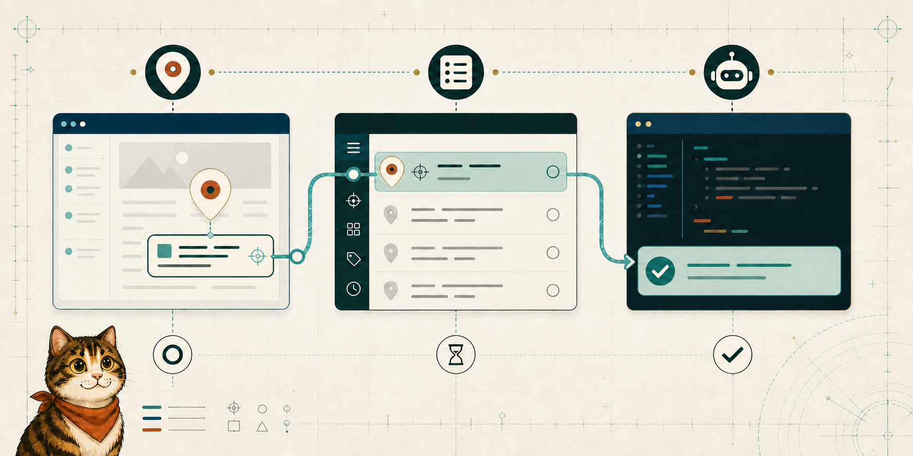

<p align="center">
  
</p>

# Logbook Waypoint

[](LICENSE)
[](https://github.com/logbookfordevs/logbook-waypoint)

**Pin the point. Chart the change.**

Logbook Waypoint is a local-first visual feedback tool for developers and coding agents. Place annotations directly on a development interface, preserve the surrounding element context, and let a coding agent read and resolve the resulting queue through the `waypoint` CLI and skill.

> [!NOTE]
> The Waypoint CLI is available through npm and checksummed GitHub Releases. Install the browser extension from the [Chrome Web Store](https://chromewebstore.google.com/detail/logbook-waypoint/fgondknhkpekdhbbkgodokmpnpadfedo).

> [!TIP]
> **Prefer a visual tour?** Open the interactive [Waypoint Signal Chart](https://tot.page/I3pC-z9cCejNITMc7Mk96Q/index.html@b5f1d9e0955ce3411ccf9709e3d05bd89415a8bd) for the extension, Queue, and agent workflow. Its agent-integration map may predate the current CLI and skill workflow.

## Current foundation

The initial MIT foundation already provides:

- Visual annotations on localhost and local development domains
- Multi-page annotation capture
- Local browser and server persistence
- Optional screenshots and element context
- A local server with an HTTP API
- Commands for surveying, inspecting, claiming, releasing, resolving, discarding, deleting, and exporting annotations
- A Chrome-compatible unpacked extension

Waypoint now adds a Logbook-native experience, a clearer work queue, an agent CLI and skill, Variants, Source Identity, and coding-agent setup on top of that foundation.

Annotations move from Pending to Claimed before agent work. Release or inactivity expiry returns them to Pending; resolve and discard retain terminal history. Permanent deletion remains a separate explicit operation.

The Queue shows whether local changes are up to date, waiting to sync, or blocked because the server is unavailable. **Sync now** retries the current project's pending work. Saves, deletions, and Design or Variant Intent removals remain recoverable locally until synchronization succeeds.

## Journal mode

Switch to **Journal** for personal notes displayed as taped paper with hand-drawn highlights and arrows. Pin with a click or Enter, edit in place, drag notes, hide the whole journal, or copy the visible page as an image. Named journals remain on your device, separate from Agent requests and the agent CLI.

See the [Journal guide](docs/JOURNAL_MODE.md) for setup, screenshot permissions, URL matching, and storage cleanup.

## Architecture

Logbook Waypoint currently has three parts:

1. **Browser extension** (`packages/extension/`) — captures and manages visual annotations and builds with WXT.
2. **Local server and CLI** ([package guide](packages/server/README.md)) — persists annotations on `127.0.0.1:3846` and gives coding agents the `waypoint` CLI.
3. **Marketing and documentation website** (`packages/website/`) — explains the workflow and hosts the development-stage product guides.

The extension, server, package, CLI, storage keys, and Annotation IDs use the canonical identifiers defined in [the product identifier contract](docs/contracts/product-identifiers.md). Waypoint starts with its own empty storage and does not import settings or Annotations from predecessor products.

## Documentation

- [Documentation map](docs/README.md) — guides, contracts, specifications, architectural decisions, package docs, and release notes
- [User guide](docs/USER_GUIDE.md) — first Annotation, Queue management, copy/export, agent setup, Design Actions, and settings
- [Agent CLI guide](docs/CLI_GUIDE.md) — normal agent workflow, compact Survey, diagnostic Inspect, and the command reference
- [Waypoint agent skill](skills/waypoint/SKILL.md) — repository source for the installable agent workflow
- [Privacy policy](PRIVACY.md) — local data handling, permissions, retention, and disclosure
- [Domain language](CONTEXT.md)
- [Architectural decisions](docs/adr/)
- [Behavioral contracts](docs/contracts/)
- Release notes: [product](CHANGELOG.md) · [server](packages/server/CHANGELOG.md)

## Development setup

Install the pnpm workspace once from the repository root:

```bash
pnpm install
```

Build and verify the workspace packages:

```bash
pnpm check
pnpm test
pnpm build
```

### Marketing and documentation website

The website is part of the pnpm workspace and remains unpublished while Waypoint is in development. The homepage is the React port of the approved OpenDesign **Waypoint Ink Map Journey**; the existing documentation routes remain available at `/docs`.

Run the local site from the repository root:

```bash
pnpm site:dev
```

Open the localhost URL printed by Next.js (normally `http://localhost:3000`). To choose a specific port, use `pnpm site:dev --hostname 127.0.0.1 --port 3041`.

Its package-level checks are:

```bash
pnpm --filter @logbookfordevs/waypoint-website test
pnpm --filter @logbookfordevs/waypoint-website check
pnpm --filter @logbookfordevs/waypoint-website lint
pnpm --filter @logbookfordevs/waypoint-website build
```

After a build, preview the production site with `pnpm --filter @logbookfordevs/waypoint-website start --hostname 127.0.0.1 --port 3042`.

The [OpenDesign source reference](docs/references/waypoint-opendesign/README.md) records provenance and the port boundaries. The homepage supports checkpoint navigation, scroll/swipe and keyboard-triggered travel, replay, reduced motion, and a readable no-WebGL fallback.

## CLI installation

Tagged releases provide the `waypoint` CLI through npm and a checksummed GitHub release archive. The curl installer is recommended for agent workflows because it installs the CLI and Waypoint skill together.

Recommended: install the latest verified GitHub release:

```bash
curl -fsSL https://waypoint.logbookfordevs.com/install.sh | bash
```

Alternatively, install the CLI through npm, then install the skill separately:

```bash
npm install --global @logbookfordevs/waypoint
npx skills@latest add logbookfordevs/logbook-waypoint --skill waypoint --global
```

Use npm without a permanent installation for a first look:

```bash
npx @logbookfordevs/waypoint --help
```

For either installed channel, run `waypoint update` to update the CLI. GitHub installer updates also reinstall its bundled skill; npm updates run the Skills CLI to refresh the skill. Restart the Waypoint server afterward with `waypoint restart`.

If an older npm installation runs `waypoint update` for the first time, its old updater may not refresh the skill during that upgrade. Run the separate `npx skills@latest add` command above once; later updates use the new behavior.

### Start Waypoint

After installing with either method, start the server:

```bash
waypoint start
```

Waypoint runs in the background by default. Use `waypoint status` to check it,
`waypoint logs` to inspect it, and `waypoint stop` when you are finished. For a
temporary terminal-attached session, use `waypoint start --foreground`.

### Read from an agent

Waypoint does not watch for new work. Annotate in the browser, then ask your agent to read Waypoint for the project. The skill runs the CLI for you:

```bash
waypoint read http://localhost:3000/
```

Every agent command prints one JSON payload, and the server must be running. See the [Agent CLI guide](docs/CLI_GUIDE.md) for the workflow and every command.

### Local development

When running Waypoint directly from this repository instead of an installed
release:

```bash
pnpm --filter @logbookfordevs/waypoint start
```

### Browser extension

Build the extension from the repository first with `pnpm build`, then:

1. Open `chrome://extensions` in a Chromium browser.
2. Enable **Developer mode**.
3. Choose **Load unpacked**.
4. Select this repository's `packages/extension/.output/chrome-mv3/` directory.

### Connect a coding agent

Agents use the `waypoint` CLI, guided by the bundled `waypoint` skill. There is no MCP server to configure. The GitHub installer installs the CLI and the skill together, globally for the universal agent target without prompts. It uses `npx --yes skills@latest add` with `--global --agent universal --skill waypoint --yes`. Pass `--skip-skill` to opt out; the installer remembers this for updates. Pass `--yes` to re-enable installation. A skill-install failure leaves the CLI installed and prints a retry command.

To install only the skill, run:

```bash
npx --yes skills@latest add logbookfordevs/logbook-waypoint --global --agent universal --skill waypoint --yes
```

To select a specific harness yourself, run `npx skills@latest add logbookfordevs/logbook-waypoint --skill waypoint --global`. If the `waypoint` skill is missing, `waypoint --help` tells agents to ask you before installing it.

The skill teaches agents to infer the current loopback development URL, read it optimistically even before it contains Annotations, begin with compact Survey context, claim before editing, and finish the lifecycle. An explicit empty project scope returns an empty Queue rather than an error. `waypoint read` accepts either a URL scope or an exact Annotation ID. See the [Agent CLI guide](docs/CLI_GUIDE.md) for the complete workflow and the [Annotation Context contract](docs/contracts/annotation-context.md) for the canonical projection, compatibility, and trust boundaries.

Agents without skill support, or without a shell, can use the extension's copy and paste flow instead.

#### Migrating from MCP

Earlier releases registered a `logbook-waypoint` MCP server. MCP and `waypoint watch` have been retired because MCP tool definitions cost context in every agent session, even when nobody is annotating. To migrate, run the installer again, which updates the CLI and skill and removes the old MCP registration from global agent configurations (set `WAYPOINT_SKIP_MCP_CLEANUP=1` to opt out). For npm installs, run `waypoint update` and then `waypoint cleanup-mcp`. Remove any project-level `logbook-waypoint` MCP entries yourself.

### Design Actions setup

Design Actions let you pair the normal Annotation comment with one Impeccable design discipline—such as Polish, Layout, Typeset, or Animate—or leave the action in Freeform. Turn on **Design Actions** in the Annotation editor, choose an action if one fits, and save the request to the normal Waypoint Queue.

See [Use Design Actions](docs/DESIGN_ACTIONS.md) for the complete authoring flow, action catalog, Variant behavior, Queue outcomes, and troubleshooting expectations.

Design Actions require [Impeccable](https://github.com/pbakaus/impeccable). Install it through Impeccable's current agent-specific instructions; Waypoint neither installs it nor detects whether it is available.

- **Tested:** no agent-specific Impeccable installation path is certified by Waypoint in this initial integration.
- **Expected:** paths documented by Impeccable should work when the coding agent can load the installed skill and run the `waypoint` CLI.
- **Unknown:** unlisted agents, custom skill locations, and future Impeccable versions remain unverified.

The `Show Design Actions` preference only controls authoring UI for new Annotations. Reopening an Annotation with saved Design Intent always reveals its Design Actions state.

Waypoint owns the Design Actions workflow and Annotation lifecycle; Impeccable supplies the external design discipline, not a second work-state system. An authored Design Intent may include separate Variant Intent. After an agent generates candidates and submits browser-presentable implementations, Waypoint stores and governs the Variant Set, its Active Variant, atomic candidate replacement, and the cleanup decision. The coding agent reconciles temporary source Scaffold after Keep or Cancel.

If the requested workflow is unavailable or execution fails recoverably, the agent releases the Annotation to Pending with a safe Work Notice. Successful Design Actions require and retain a provider-neutral Resolution Record with a short outcome and verification evidence; ordinary Annotations resolve without one. Application routes and repository-relative source paths are valid evidence, while machine-specific absolute paths and provider-internal material are not. Survey keeps Queue context compact, and Inspect exposes the complete record for selected Annotations.

## Security boundary

The server binds only to IPv4 loopback, validates local Host and Origin headers, validates Annotation IDs, and labels page-derived agent CLI output as untrusted. The extension exposes no public page-world automation bridge. See [SECURITY.md](SECURITY.md) for the active boundary.

## Project lineage

Logbook Waypoint begins from Vibe Annotations commit [`8864e12`](https://github.com/RaphaelRegnier/vibe-annotations/commit/8864e12cfb28c6825ef6ccf996d291fc2b0ebcd4), the final repository commit distributed under the MIT License before its upstream license change.

The original MIT copyright and permission notice are preserved in [LICENSE](LICENSE). Additional lineage details are recorded in [NOTICE.md](NOTICE.md).

Logbook Waypoint is an independent project and is not affiliated with or endorsed by Raphael Regnier or Spellbind Creative Studio. “Vibe Annotations” and its original visual identity belong to their respective owner.

## Contributing

The project is intentionally early. Before proposing a large change, open an issue describing the problem, rationale, and smallest useful solution. See [CONTRIBUTING.md](CONTRIBUTING.md) for the Waypoint-specific setup, change expectations, validation, and pull request guidance.

## Support the voyage

If Logbook Waypoint helps your workflow, you can support Logbook for Devs:

- [Buy me a coffee — 5](https://ko-fi.com/logbookfordevs?amount=5)
- [Buy me lunch — 15](https://ko-fi.com/logbookfordevs?amount=15)
- [Buy me dinner — 30](https://ko-fi.com/logbookfordevs?amount=30)
- [Choose an amount on Ko-fi](https://ko-fi.com/logbookfordevs)
- [Support on Buy Me a Coffee](https://buymeacoffee.com/logbookfordevs)

## License and attribution

MIT — see [LICENSE](LICENSE).

A tool from the [Logbook for Devs](https://logbookfordevs.com/)

Charting the technical seas, one commit at a time.
